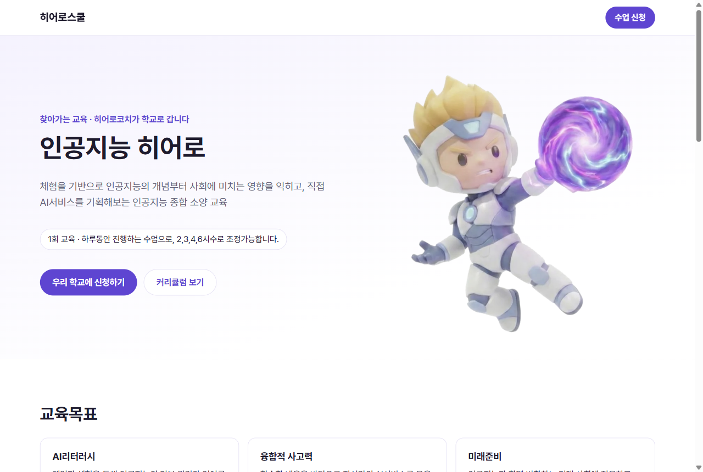
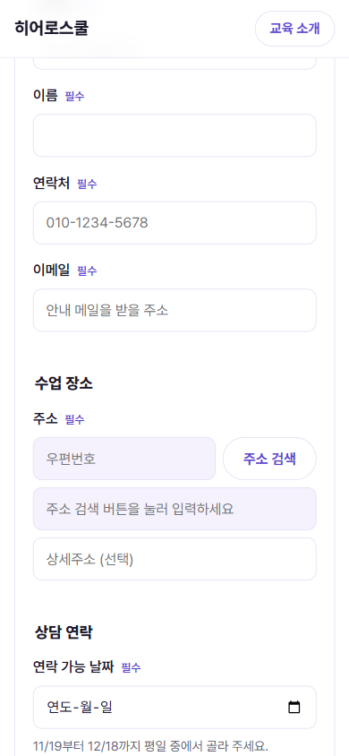
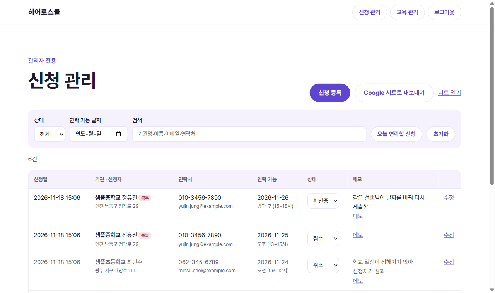
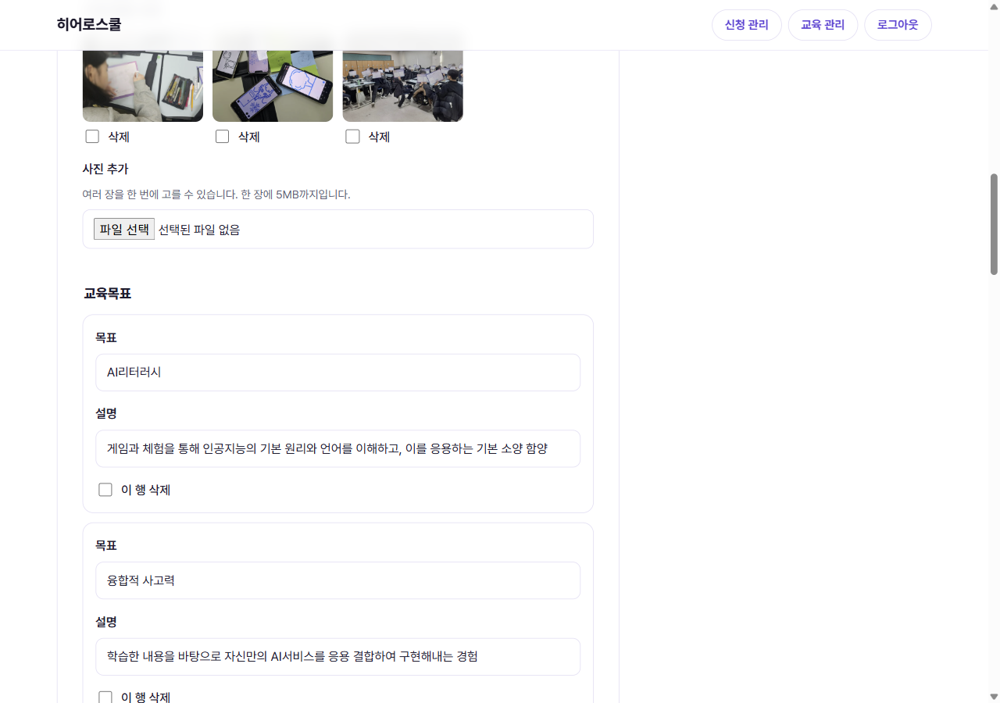
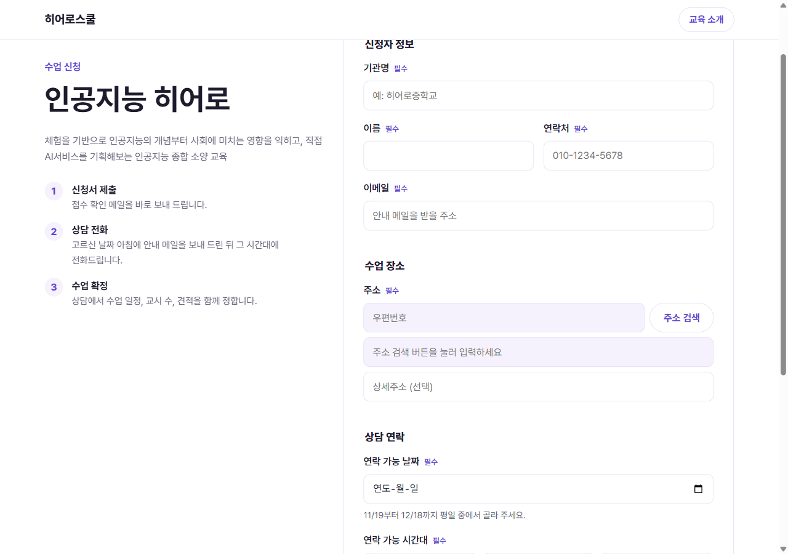

# 히어로스쿨 찾아가는 교육 신청 시스템

교육 소개, 신청 접수, 신청 관리로 이어지는 흐름을 Django, DRF, PostgreSQL로 만든 채용 과제입니다. 소개 콘텐츠는 히어로스쿨의 인공지능 히어로 과정([hero-school.net](https://hero-school.net/visit/ai/))을 썼습니다.

## 접속 정보

| 항목 | 주소 |
|---|---|
| 교육 소개 (첫 화면) | https://3-35-123-81.sslip.io |
| 교육 신청 | https://3-35-123-81.sslip.io/courses/ai-hero/apply/ |
| 관리자 로그인 | https://3-35-123-81.sslip.io/manage/login/ |
| 신청 관리 | https://3-35-123-81.sslip.io/manage/applications/ |
| 교육 관리 | https://3-35-123-81.sslip.io/manage/courses/ |
| 교육 API | https://3-35-123-81.sslip.io/api/courses/ai-hero/ |
| 신청 API (관리자 로그인 후) | https://3-35-123-81.sslip.io/api/applications/ |
| 내보낸 신청 목록 시트 (보기 전용) | https://docs.google.com/spreadsheets/d/1BTzX9WFdMRm8VZBrrv3oEJruidhbTcK1a7-YuvJb7ps |
| Django admin (화면에서 링크하지 않음) | https://3-35-123-81.sslip.io/admin/ |

| 계정 | 아이디 | 비밀번호 | 권한 |
|---|---|---|---|
| 리뷰어 | `reviewer` | `OyXN7IVcraZF2W` | 관리자. 신청과 교육 데이터를 모두 다룸 |
| 소유자 | `owner` | `0ZXwHytMZlteAcH7` | 슈퍼유저. Django admin에서 사용자 계정까지 다룸 |

과제 확인용 데모라서 계정을 공개합니다. 실제 서비스라면 공개하지 않습니다. 확인은 `reviewer` 계정으로 충분합니다.

- 메일은 `eosseomseukul@gmail.com`에서 나갑니다. 스팸함에 들어갈 수 있습니다.
- 신청 폼에 적은 내용은 관리자 화면과 위 시트에 그대로 보입니다. 시트는 링크만 있으면 누구나 볼 수 있습니다. 그러니 이메일 말고는 예시 값으로 적어 주세요.
- 데모 데이터가 망가져도 서버에서 `python manage.py seed`로 교육 내용을 되돌릴 수 있습니다.

## 화면

| 교육 소개 | 교육 신청 (모바일) |
|---|---|
|  |  |

| 신청 관리 | 교육 관리 |
|---|---|
|  |  |



## 확인 방법

데모 서버에서 아래 순서대로 확인하면 과제 항목을 모두 볼 수 있습니다. 괄호 안은 해당 과제 항목입니다.

### 1. 교육 소개 페이지 (필수: 교육 소개)

1. https://3-35-123-81.sslip.io 를 엽니다. 교육이 하나뿐이라 인공지능 히어로 소개 페이지로 바로 넘어갑니다.
2. 교육명, 한 줄 소개, 대표 이미지, 교육목표 3개, 6교시 커리큘럼, 추천 대상, 수업 현장 사진 3장이 차례로 보입니다.
3. 브라우저 폭을 줄이거나 개발자 도구의 모바일 보기로 바꾸면 카드와 커리큘럼이 한 줄씩 쌓입니다.

### 2. 교육 신청 (필수: 신청 페이지, 반응형, Ajax)

1. 소개 페이지의 "우리 학교에 신청하기"를 누르거나 https://3-35-123-81.sslip.io/courses/ai-hero/apply/ 를 엽니다.
2. 먼저 잘못된 값으로 "신청하기"를 눌러 봅니다. 페이지가 새로 고쳐지지 않고 칸마다 오류가 붙습니다.
   - 아무것도 적지 않으면 필수 항목 오류가 납니다.
   - 연락처에 `12345`를 적으면 형식 오류가 납니다.
   - 연락 가능 날짜에 토요일이나 일요일을 고르면 주말 오류가 납니다. 날짜는 내일부터 30일 안의 평일만 고를 수 있습니다.
   - 개인정보 동의를 체크하지 않으면 동의 오류가 납니다.
3. "주소 검색"을 누르면 카카오 우편번호 창이 뜹니다. 주소를 고르면 우편번호와 기본주소가 채워집니다.
4. 이메일에는 메일을 받아 볼 수 있는 실제 주소를 적고 나머지는 올바르게 채워 제출합니다. 폼이 접수 완료 안내로 바뀝니다.
5. 같은 IP에서 한 시간에 20번까지 신청할 수 있습니다. 넘으면 잠시 뒤에 다시 시도하라는 안내가 나옵니다.

### 3. 자동 안내 메일 (필수: 연락 가능 날짜 기준 자동 메일)

1. 2번에서 신청하고 1분 안에 "[히어로스쿨] 인공지능 히어로 수업 신청이 접수되었습니다" 메일이 옵니다. 서버의 cron이 1분마다 보낼 메일을 찾아 보냅니다.
2. 연락 안내 메일은 원래 연락 가능 날짜 당일 08시에 나갑니다. 08시 이후라면 기다리지 않고 확인할 수 있습니다. 관리자 화면에서 방금 낸 신청을 열고 연락 가능 날짜를 오늘로 바꿔 저장합니다. 관리자 화면에서는 날짜 제한이 없습니다.
3. 1분 안에 "[히어로스쿨] 오늘 ○○에 상담 전화를 드립니다" 메일이 옵니다. 그 신청의 수정 화면 아래 "연락 안내 메일" 칸에 보낸 시각이 찍힙니다.
4. 날짜를 다른 날로 다시 바꾸면 그 칸이 "보내기 전"으로 돌아갑니다. 새 날짜 아침에는 안내 메일이 다시 나갑니다. 상태를 완료나 취소로 바꾸면 안내 메일이 나가지 않습니다.

### 4. 관리자 로그인과 신청 관리 (필수: 신청 관리 CRUD와 상태, 우대: 관리자 전용 페이지)

1. https://3-35-123-81.sslip.io/manage/ 에 들어가면 로그인 화면으로 넘어갑니다. `reviewer` 계정으로 로그인합니다.
2. 신청 관리 목록에 데모 신청 6건과 2번에서 낸 신청이 보입니다.
   - 샘플중학교 정유진 신청 두 건에는 "중복" 배지가 붙어 있습니다. 같은 이메일로 낸 진행 중 신청이 두 건이기 때문입니다. 둘 중 하나를 취소로 바꾸면 배지가 사라집니다.
   - 완료와 취소 상태인 행은 흐리게 보입니다. 연락 가능 날짜가 오늘인 행은 노란 배경으로 강조됩니다.
3. 상태 칸을 바꾸면 그 자리에서 저장됩니다(Ajax). "메모"를 누르면 메모 창이 뜨고 저장하면 목록에 바로 보입니다.
4. 상태, 연락 가능 날짜, 검색어(기관명, 이름, 이메일, 연락처)로 걸러 봅니다. "오늘 연락할 신청"은 연락 가능 날짜를 오늘로 채웁니다.
5. "신청 등록"으로 전화 문의를 대신 입력하는 상황을 확인합니다. "접수 확인 메일 보내기"를 끄고 등록하면 그 신청에는 접수 확인 메일이 나가지 않습니다.
6. 행의 "수정"을 누르면 모든 항목을 고칠 수 있습니다. 화면 아래에 신청 시각, 수정 시각, 메일 발송 시각이 보입니다.
7. 수정 화면의 "삭제"를 누르면 확인 페이지를 거쳐 삭제합니다. 기록을 남기려면 삭제 대신 상태를 취소로 바꿉니다.

### 5. Google 시트 내보내기 (우대: Google Spreadsheet 연동)

1. 신청 관리 화면의 "Google 시트로 내보내기"를 누릅니다. "시트에 N건을 내보냈습니다"가 나옵니다.
2. "시트 열기"나 위 접속 정보의 시트 링크를 엽니다. 맨 윗줄 안내문, 머리글, 신청 목록이 들어 있습니다.
3. 우편번호 `04524`, 연락처 `010-…`처럼 0으로 시작하는 값이 숫자로 바뀌지 않고 그대로 남아 있습니다.
4. 서버는 매일 08시에도 시트를 자동으로 덮어씁니다.

### 6. 교육 관리

1. 상단의 "교육 관리"에서 인공지능 히어로의 "수정"을 엽니다.
2. 교육명, 한 줄 소개, 추천 대상을 고치고 대표 이미지와 수업 현장 사진을 올리거나 지울 수 있습니다. 이미지는 5MB까지 올릴 수 있고 이미지가 아닌 파일은 거절됩니다.
3. "목표 추가", "교시 추가"로 행을 더하고 "이 행 삭제"로 지웁니다. 두 교시의 번호를 맞바꿔 저장할 수도 있습니다. 같은 교시 번호를 두 번 쓰면 오류가 납니다.
4. "교육 추가"로 새 교육을 만들면 첫 화면이 교육 목록으로 바뀝니다. 새 교육의 소개 페이지와 신청 페이지도 바로 열립니다.
5. 인공지능 히어로의 "삭제"를 누르면 신청이 있어서 삭제할 수 없다고 나옵니다. 새로 만든 교육은 신청이 없으니 삭제됩니다.

### 7. API (필수: DRF GET, POST API)

교육 정보와 신청 접수는 로그인 없이 호출할 수 있습니다.

```bash
# 교육 정보와 커리큘럼 (GET)
curl https://3-35-123-81.sslip.io/api/courses/ai-hero/

# 신청 접수 (POST). 연락 가능 날짜는 내일부터 30일 안의 평일로 바꿔서 보냅니다.
curl -X POST https://3-35-123-81.sslip.io/api/applications/ -H 'Content-Type: application/json' -d '{
  "course": "ai-hero", "organization": "API 확인 학교", "name": "API", "email": "you@example.com",
  "phone": "010-1234-5678", "postcode": "07276", "address": "서울 영등포구 선유서로25길 28",
  "contact_date": "2026-11-20", "contact_slot": "after_school", "privacy_agreed": true }'

# 잘못된 값을 보내면 400과 함께 필드별 오류가 옵니다.
curl -X POST https://3-35-123-81.sslip.io/api/applications/ -H 'Content-Type: application/json' -d '{"course": "ai-hero"}'

# 신청 목록은 관리자만 볼 수 있어서 로그인하지 않으면 403입니다.
curl -i https://3-35-123-81.sslip.io/api/applications/
```

관리자로 로그인한 브라우저에서 https://3-35-123-81.sslip.io/api/applications/ 를 열면 DRF 화면으로 목록을 볼 수 있습니다. `?status=received`, `?contact_date=2026-11-20`, `?q=히어로`로 거를 수 있습니다. 각 신청에는 `is_duplicate`가 붙습니다. 개별 신청(`/api/applications/<id>/`)은 PATCH로 상태와 메모만 바꿀 수 있습니다.

### 8. Django admin

`/admin/`도 남아 있습니다. 관리 화면을 새로 만들었기 때문에 화면 어디에서도 링크하지 않습니다. `reviewer` 계정으로 들어가면 교육과 신청만 보입니다. `owner` 계정으로 들어가면 사용자 계정까지 보입니다.

### 9. 로컬에서 테스트 돌리기

아래 [로컬에서 실행하기](#로컬에서-실행하기)와 [테스트](#테스트)를 따르면 됩니다. 테스트 19개가 검증, 권한, 메일 발송 시점, 시트 내보내기, 관리 화면 동작을 확인합니다.

## 과제 요구사항 대응

| 요구사항 | 구현 | 위치 |
|---|---|---|
| 교육 소개 페이지 | 교육명, 한 줄 소개, 교육목표, 6교시 커리큘럼, 추천 대상, 수업 현장 사진, 대표 이미지 | `/courses/ai-hero/` |
| 교육 신청 페이지 | 기관명, 이름, 이메일, 연락처, 주소(카카오 우편번호), 연락 가능 날짜와 시간대, 개인정보 동의. 모바일 화면부터 짠 반응형. `fetch`로 제출한 뒤 결과와 오류를 페이지 이동 없이 보여 줌 | `/courses/ai-hero/apply/` |
| 신청 저장·조회·수정·삭제 | 관리 화면에서 신청을 등록, 수정, 삭제함. 삭제는 확인 페이지를 거침. 목록에서는 상태와 메모를 바로 저장함 | `/manage/applications/` |
| 신청 상태 구분 | 접수, 확인중, 완료, 취소 | `Application.Status` |
| Django와 PostgreSQL 모델 | `Course`, `CurriculumItem`, `Application` | `education/models.py` |
| DRF GET·POST API | 아래 [API](#api) 표 참고 | `education/views.py` |
| 연락 가능 날짜 기준 자동 안내 메일 | 제출 후 1분 안에 접수 확인 메일, 연락 가능 날짜 당일 08:00에 연락 안내 메일 | `education/mails.py`, `deploy/crontab` |
| (우대) 관리자 전용 페이지 | Django admin 대신 쓰는 관리 화면과 로그인 페이지. 신청 목록에는 상태·날짜 필터, 검색, 오늘 연락할 신청 강조, 중복 신청 표시, 상태와 메모 Ajax 저장이 있음. 교육 관리에서는 교육을 추가·수정·삭제하고 대표 이미지와 현장 사진을 올리고 교육목표와 커리큘럼을 행 단위로 고침 | `/manage/`, `education/staff_views.py` |
| (우대) Google Sheets 내보내기 | 관리자 화면 버튼과 매일 08:00 자동 덮어쓰기 | `education/sheets.py` |
| (우대) AWS 배포 구성 | EC2, RDS, Caddy(HTTPS)로 실제 배포하고 생성·배포·삭제 스크립트를 둠 | [docs/AWS.md](docs/AWS.md) |
| (우대) AI 코딩 보조 도구 사용 내역 | 단계별 사용 내역과 사람이 판단하고 검증한 부분 | [docs/AI_USAGE.md](docs/AI_USAGE.md) |

## 설계에서 정한 것

용어는 [CONTEXT.md](CONTEXT.md)에 정리했고 코드와 화면 문구가 이 용어를 따릅니다.

- **신청자는 학교·기관 담당자입니다.** 히어로스쿨은 강사가 학교로 찾아가는 B2B 수업이 주력입니다. 그래서 신청 폼의 주소를 수업이 열리는 기관의 주소로 보고 기관명을 필수로 받습니다. 근거는 [ADR 0001](docs/adr/0001-applicant-is-organization-staff.md)에 있습니다.
- **연락 가능 날짜는 상담 전화를 받을 날입니다.** 수업 날짜가 아닙니다. 날짜와 함께 시간대(오전, 오후, 방과 후)를 받습니다. 그 시간대에 전화하려면 번호가 있어야 하므로 연락처도 받습니다. 날짜는 내일부터 30일 안의 평일만 고를 수 있습니다.
- **상태는 접수, 확인중, 완료, 취소 네 가지입니다.** 완료는 상담 전화가 끝났다는 뜻입니다. 취소를 삭제와 구분해 이력을 남깁니다. 취소된 신청에는 안내 메일이 나가지 않습니다.
- **중복 신청은 막지 않고 관리자에게 보여 줍니다.** 같은 이메일로 같은 교육에 낸 신청 가운데 접수·확인중인 것이 둘 이상이면 관리자 화면에 "중복" 배지가 붙습니다. 제출 버튼은 전송 중에 비활성화해서 더블클릭만 막습니다.
- **관리 화면은 Django admin과 따로 만들었습니다.** 관리자가 매일 쓰는 화면이라 사이트와 같은 디자인과 용어를 씁니다. 등록, 수정, 삭제, 교육 편집은 서버에서 그리는 Django 폼으로 처리합니다. 목록의 상태와 메모 저장만 `fetch`와 API로 합니다. Django admin은 `/admin/`에 남겨 두었지만 화면 어디에서도 링크하지 않습니다.
- **메일은 1분마다 도는 명령 하나가 보냅니다.** 신청 요청 안에서는 SMTP를 부르지 않습니다. `send_mails`는 발송할 때가 된 메일을 DB에서 찾아 보내고 발송 시각을 기록합니다. 그래서 같은 메일이 두 번 가지 않습니다. 실패한 메일은 기록하지 않으므로 다음 실행에서 다시 보냅니다. 서버가 08:00에 꺼져 있었다면 다시 켜진 뒤 그날 안내 메일을 보냅니다. Redis나 Celery 없이 cron과 `flock`만 씁니다.
- **메일 규칙은 데이터에 둡니다.** 관리자가 전화 문의를 대신 등록할 때는 접수 확인 메일을 끌 수 있습니다. 그 선택은 신청의 `send_confirmation` 필드에 남습니다. 관리자가 연락 가능 날짜를 바꾸면 새 날짜 아침에 안내 메일이 다시 나갑니다. 안내 메일은 연락 가능 날짜 당일에만 나가므로 `send_mails`는 오늘 날짜로 된 발송 기록이 있는지만 봅니다. 그래서 날짜를 어느 화면에서 바꾸든 따로 기록을 지울 필요가 없습니다.
- **시트는 보고용 사본입니다.** 내보낼 때마다 시트 전체를 DB 내용으로 덮어쓰므로 몇 번을 실행해도 결과가 같습니다. 시트에서 고친 내용은 다음 내보내기 때 사라집니다. 수정은 관리자 화면에서 합니다. Google API에 장애가 나도 신청 접수는 영향을 받지 않습니다.
- **개인정보 동의는 필수 체크박스만 둡니다.** 실제 운영을 전제로 하지 않아서 동의 여부는 저장하지 않습니다. 체크하지 않으면 접수되지 않습니다.

## 데이터 모델

```
Course 교육 (교육명, 주소 이름, 한 줄 소개, 수업형태, 추천 대상, 대표 이미지)
  ├─< CourseGoal 교육목표 (목표, 설명)
  ├─< CurriculumItem 커리큘럼 (교시, 주제, 활동, 내용)
  ├─< CoursePhoto 수업 현장 사진
  └─< Application 신청
        기관명, 이름, 이메일, 연락처, 우편번호, 기본주소, 상세주소,
        연락 가능 날짜, 연락 가능 시간대, 상태, 관리자 메모, 접수 확인 메일 보내기 여부,
        신청·수정 시각, 접수 확인 메일 발송 시각, 연락 안내 메일 발송 시각
```

- `Application.course`는 `PROTECT`입니다. 신청이 있는 교육은 지울 수 없습니다.
- `(contact_date, status)` 인덱스는 매일 아침 오늘 연락할 진행 중 신청을 찾는 데 씁니다.
- 연락처와 우편번호 형식은 모델 검증기가 검사합니다. 날짜 범위, 주말, 동의는 신청 시점을 기준으로 하므로 공개 API의 serializer에서만 검사합니다. 그래야 관리자가 지난 신청을 고칠 때 막히지 않습니다. 관리 화면의 폼도 같은 이유로 날짜를 제한하지 않습니다.

## API

| 메서드 | 경로 | 권한 | 설명 |
|---|---|---|---|
| GET | `/api/courses/<slug>/` | 공개 | 교육 정보와 커리큘럼 |
| POST | `/api/applications/` | 공개, IP당 시간당 20회 | 신청 접수. `status`를 보내도 항상 `접수`로 저장 |
| GET | `/api/applications/?status=&contact_date=&q=` | staff | 신청 목록. 중복 여부(`is_duplicate`) 포함 |
| GET | `/api/applications/<id>/` | staff | 신청 상세 |
| PATCH | `/api/applications/<id>/` | staff | 상태와 관리자 메모만 수정 |
| POST | `/api/exports/sheets/` | staff | 신청 목록 시트 덮어쓰기 |

인증은 관리자 로그인 세션을 그대로 씁니다. 신청 등록, 수정, 삭제와 교육 편집은 API가 아니라 관리 화면에서 합니다.

```bash
curl -X POST https://3-35-123-81.sslip.io/api/applications/ -H 'Content-Type: application/json' -d '{
  "course": "ai-hero", "organization": "히어로중학교", "name": "김민지", "email": "minji@example.com",
  "phone": "010-1234-5678", "postcode": "07276", "address": "서울 영등포구 선유서로25길 28",
  "contact_date": "2026-11-20", "contact_slot": "after_school", "privacy_agreed": true }'
```

## 로컬에서 실행하기

[uv](https://docs.astral.sh/uv/)와 Docker가 필요합니다. CSS를 고칠 때는 Node.js도 필요합니다.

```bash
cp .env.example .env
docker compose up -d db                               # PostgreSQL 17
uv run --env-file .env python manage.py migrate
uv run --env-file .env python manage.py seed           # 교육 시드 데이터와 이미지(media/)
uv run --env-file .env python manage.py createsuperuser
uv run --env-file .env python manage.py runserver     # http://127.0.0.1:8000
uv run --env-file .env python manage.py send_mails    # EMAIL_HOST_USER가 비어 있으면 메일을 콘솔에 출력
npm install && npm run css                            # SCSS를 static/css/main.css로 빌드
```

메일을 실제로 보내려면 `.env`에 Gmail 주소와 [앱 비밀번호](https://myaccount.google.com/apppasswords)를 넣습니다. `EMAIL_HOST`를 바꾸면 SES 같은 다른 SMTP 서버로 옮길 수 있습니다. 시트 내보내기를 쓰려면 서비스 계정 JSON 경로와 시트 ID를 넣습니다. 시트는 서비스 계정 이메일에 편집자로 공유합니다.

## 테스트

```bash
uv run --env-file .env python manage.py test education
```

테스트 19개가 다음을 확인합니다.

- 신청 검증: 날짜 범위, 주말, 개인정보 동의, 연락처 형식
- 권한과 중복 표시, 관리자가 수정할 수 있는 필드의 범위
- 메일 발송 시점, 같은 메일 재발송 방지, 발송 실패 후 재시도
- 시트 내보내기 (Google 호출은 mock)
- 관리 화면: 로그인 요구, 관리자 등록 때 확인 메일 끄기, 날짜를 바꾸면 안내 메일 다시 발송, 화면의 안내 메일 표시, 신청 삭제, 이미지와 교육목표와 커리큘럼을 담은 교육 추가, 교시 맞바꾸기, 겹치는 교시와 남의 사진 번호를 폼 오류로 처리, 신청이 있는 교육의 삭제 차단

## 하지 않은 것

- 신청 목록에 페이지네이션이 없습니다. 신청이 수천 건을 넘으면 DRF 페이지네이션을 붙입니다.
- 공휴일은 막지 않습니다. 공휴일 목록을 관리해야 해서 평일만 검사합니다.
- 신청자가 직접 신청을 조회하거나 취소하는 기능과 상태 변경 알림 메일은 없습니다. 상태는 상담 전화와 메일 회신으로 안내합니다.
- 업로드한 이미지는 EC2의 Docker 볼륨에 둡니다. 서버를 새로 만들면 사라지므로 운영이라면 S3와 `django-storages`로 옮깁니다. 지운 사진의 파일은 볼륨에 그대로 남습니다.
- 동의 이력 저장과 보유기간이 지난 데이터 파기는 실제 운영 때 필요합니다.

## 프로젝트 구조

```
config/            설정, URL
education/         모델, 공개 페이지와 API 뷰(views.py), 관리 화면 뷰(staff_views.py)와 폼(forms.py),
                   메일(mails.py), 시트(sheets.py), 관리 명령, 시드 데이터와 시드 이미지(fixtures/), 테스트
templates/         공개 페이지, 관리 화면(manage/), 메일 템플릿
static/            SCSS 원본, 빌드된 CSS, JS
deploy/            AWS 생성(aws.sh), 배포(deploy.sh), 삭제(teardown.sh), cron
docs/              AWS 구성, AI 사용 내역, ADR
CONTEXT.md         도메인 용어집
```

교육 소개 문구와 이미지의 저작권은 (주)어썸스쿨에 있습니다. 과제 데모에만 사용했습니다.
